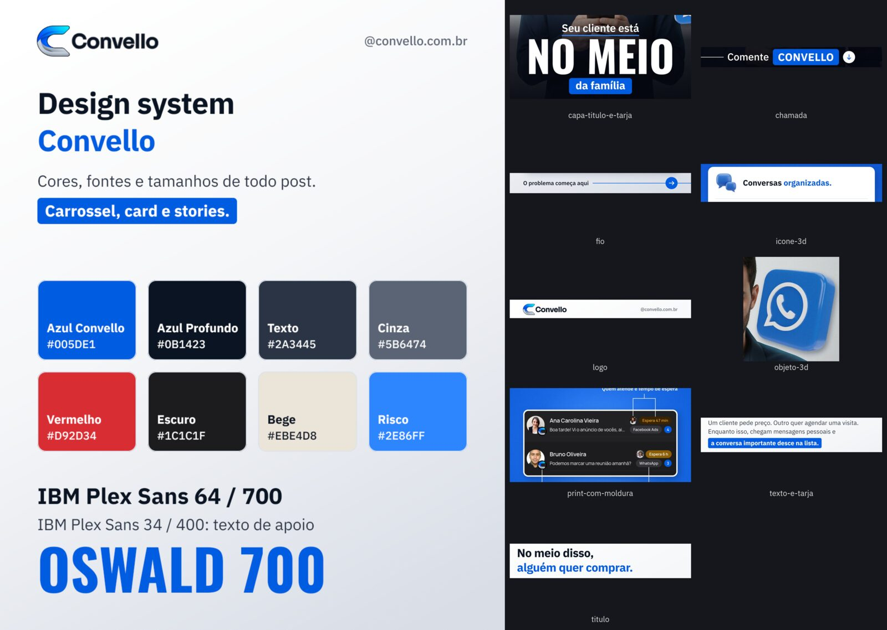
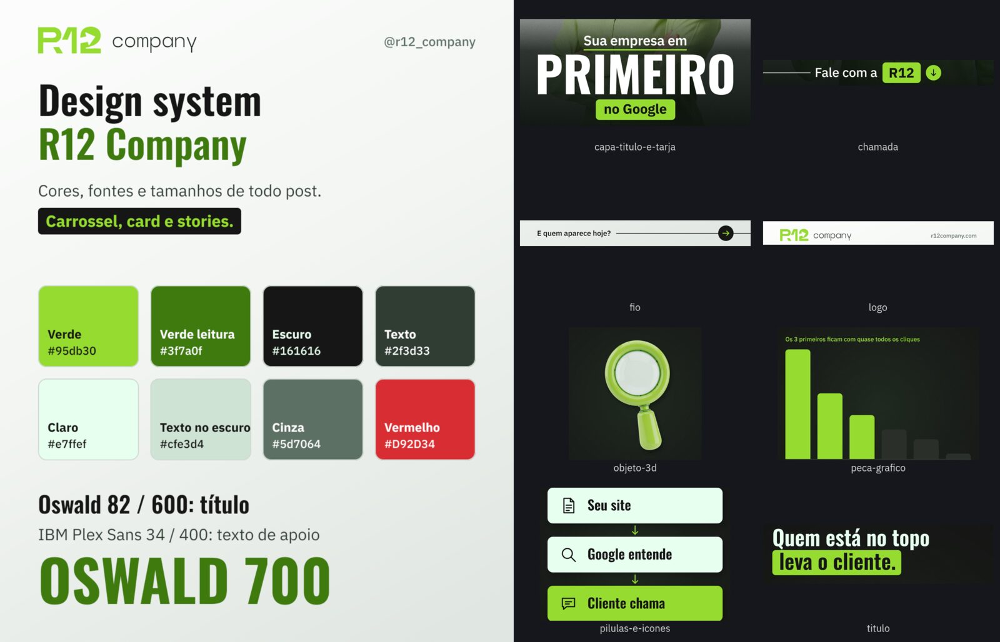

<h1 align="center">Atelier: carrosséis no padrão aprovado, montados pelo Claude</h1>

<p align="center">
  
  &nbsp;
  
</p>

<p align="center">
  Duas skills do Claude que fazem carrosséis de Instagram do <b>Convello</b> e da <b>R12 Company</b><br>
  do roteiro à legenda, no visual que as marcas aprovaram, com cada slide em PNG e em PSD com camadas.
</p>

## Instalar em 1 minuto

No Mac ou no Linux, cole no Terminal:

```bash
curl -fsSL https://raw.githubusercontent.com/r12company/atelier/main/scripts/instalar.sh | bash
```

No Windows, cole no PowerShell:

```powershell
irm https://raw.githubusercontent.com/r12company/atelier/main/scripts/instalar.ps1 | iex
```

<!-- Endereço curto (quando existir): troque os dois comandos acima pelo link no domínio do Convello. -->

O instalador copia as duas skills para o Claude Code, instala as fontes, instala o PhotoCraft no Linux e, no fim, diz o que ainda falta.
Para instalar só uma: `curl -fsSL .../instalar.sh | bash -s -- carrossel-r12`.

**Outros jeitos**

- **Como plugin do Claude Code:** dentro do Claude Code, rode `/plugin marketplace add r12company/atelier` e depois `/plugin install carrossel-convello@atelier` (ou `carrossel-r12@atelier`).
- **No Claude.ai (site ou app):** baixe o `.zip` de cada skill na página de [Releases](https://github.com/r12company/atelier/releases) e envie em Configurações > Capacidades > Skills. Lá o Claude faz roteiro, legenda e prompts; a montagem vai pelo caminho B (veja abaixo).

<details>
<summary>Para o Claude: instalar a partir deste link</summary>

Se alguém colar este link e pedir "instala essas skills":

```bash
git clone --depth 1 https://github.com/r12company/atelier /tmp/atelier
mkdir -p ~/.claude/skills
cp -R /tmp/atelier/plugins/carrossel-convello/skills/carrossel-convello ~/.claude/skills/
cp -R /tmp/atelier/plugins/carrossel-r12/skills/carrossel-r12 ~/.claude/skills/
python3 ~/.claude/skills/carrossel-convello/motor/checar.py
```

Se a pasta da skill já existir, renomeie a antiga para `<nome>.antiga` antes de copiar. Depois diga, em português simples, o que o `checar.py` apontou como falta.
</details>

## O que vem dentro

| Skill | Para que serve | Exemplo de pedido | Resultado |
| --- | --- | --- | --- |
| **Convello** | Posts do Convello, CRM de atendimento e vendas pelo WhatsApp | "faz um carrossel do Convello sobre cliente que some depois do orçamento" | 6 a 10 slides azul e branco, capa com foto, prints reais do sistema, legenda curta |
| **R12 Company** | Posts da R12 Company, agência de marketing e tráfego pago | "carrossel da R12 explicando por que anúncio sem site perde venda" | Slides verde e escuro, títulos em Oswald, gráficos e fluxos no lugar de texto |

**Três formatos:** carrossel (6 a 10 slides), card (post único) e stories (1080 x 1920, 3 a 6 telas dentro da área segura do Instagram), todos com a mesma identidade.

**Copy pronta em toda peça:** cada uma vem com um `copy.md` sempre na mesma ordem: formato e horário sugeridos, gancho, legenda para colar, chamada, hashtags, texto alternativo e o texto de cada slide.

Cada skill traz o passo a passo, as regras do que a marca aprovou e reprovou, a planta de cada slide, os moldes de layout, os modelos de prompt para as imagens e o motor que monta.

## Identidade das marcas

O design system de cada marca, com cores, fontes, medidas dos três formatos, componentes e o que nunca fazer. Dá para montar no Figma só com ele.

| Convello | R12 Company |
| --- | --- |
| [DESIGN-SYSTEM.md](plugins/carrossel-convello/skills/carrossel-convello/DESIGN-SYSTEM.md) | [DESIGN-SYSTEM.md](plugins/carrossel-r12/skills/carrossel-r12/DESIGN-SYSTEM.md) |
|  |  |

Calendário combinado: segunda, quarta e sexta, 2 posts por dia (9h e 18h) feitos com as skills; terça e quinta, motions do time do Convello; fim de semana, do dono da marca (`referencias/calendario.md`).

## Como usar

1. **Peça no Claude Code**, com o tema ou com o roteiro pronto: *"faz um carrossel do Convello sobre o que muda quando a equipe inteira atende no mesmo número"*.
2. **Gere as imagens que ele pedir.** O Claude devolve os prompts prontos e diz onde salvar cada arquivo. Você gera, escolhe a melhor e salva.
3. **Confira e poste.** A capa chega primeiro; depois a folha com todos os slides, os PNG, os PSD e a legenda. Quem posta é você.

## Como as imagens são feitas

O Claude não gera imagem: ele escreve o prompt e diz o que anexar. Você cola no **Gemini** (app ou AI Studio, modelo Nano Banana) ou no **ChatGPT** (Images).

Cada pedido vem assim:

| Pedido de imagem | Exemplo |
| --- | --- |
| **Arquivo** | `geradas/capa-pessoa.png` |
| **O que é** | a pessoa da capa, aflita, olhando o celular |
| **Onde gerar** | Gemini (proporção 3:4) ou ChatGPT (retrato) |
| **Anexar** | nada. No pedido do final, a capa aprovada, que mantém o mesmo rosto |

```text
Studio photograph of a Brazilian woman in her 40s, curly hair, green blouse. A Brazilian person
with an ordinary, real look ... Background: a very light gray studio wall, smooth and even ...
```

Os blocos dos prompts saíram das imagens que as marcas aprovaram (luz, enquadramento, objeto 3D, logo). Prints do sistema vêm do time do Convello ou de uma conta de demonstração, nunca de cliente real.

## O que precisa ter na máquina

| Item | Para quê | Como conseguir |
| --- | --- | --- |
| Claude Code | onde as skills rodam | [claude.com/claude-code](https://claude.com/claude-code) |
| Python 3, com numpy e Pillow | o motor | [python.org](https://www.python.org); depois `python3 -m pip install --user numpy pillow` |
| ImageMagick 7 | recortes e a folha final | Linux: pacote `imagemagick`; Mac: `brew install imagemagick` |
| PhotoCraft | monta cada slide em PSD com camadas | o instalador põe no Linux; Mac e Windows: [Releases do PhotoCraft](https://github.com/storytold/photocraft/releases) |
| Fontes IBM Plex Sans e Oswald | o texto dos slides | o instalador põe; os arquivos estão em `fontes/` de cada skill |

Para conferir tudo de uma vez:

```bash
python3 ~/.claude/skills/carrossel-convello/motor/checar.py
```

Se ele disser **ATELIER PRONTO PARA MONTAR**, está tudo certo. Se faltar algo, ele diz o quê e como resolver.

**Caminho B.** Sem o PhotoCraft (ou no Claude.ai), o Claude faz roteiro, legenda, prompts e uma ficha de cada slide com as medidas, e você monta no Photoshop ou no Figma seguindo a planta (`referencias/caminho-b.md`).

## Veja o resultado

<p align="center"></p>
<p align="center"></p>

## Perguntas frequentes

**Preciso saber programar?** Não. Você pede em português e o Claude faz o resto. Só copia e cola os prompts das imagens.

**Funciona no Windows?** As skills sim. A montagem automática funciona melhor dentro do WSL (o Ubuntu do Windows); sem ele, use o caminho B.

**Por que o Claude não gera as imagens sozinho?** Porque cada pessoa usa a própria conta do Gemini ou do ChatGPT. O Claude escreve o pedido no padrão aprovado e confere a imagem antes de usar.

**Posso usar para outra marca?** O método sim (licença MIT). As logos, nomes e cores do Convello e da R12, não: são marcas registradas.

**Como atualizo?** Rode o comando de instalar de novo. A versão anterior fica guardada como `<nome>.antiga`.

## Licença e marcas

Texto e código: [MIT](LICENSE). Convello, R12 e R12 Company são marcas registradas: os arquivos das pastas `marca/` só podem ser usados em material das próprias marcas.

## Créditos e licenças

O Atelier monta os slides comandando o [PhotoCraft](https://github.com/storytold/photocraft), editor de imagem de código aberto do ArtCraft Team e colaboradores (MIT ou Apache-2.0). Fontes [IBM Plex Sans](https://github.com/IBM/plex) e [Oswald](https://github.com/googlefonts/OswaldFont) (SIL Open Font License 1.1). Lista completa em [TERCEIROS.md](TERCEIROS.md).
